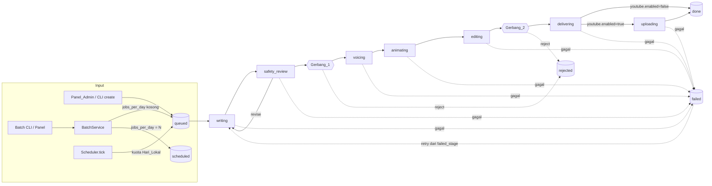
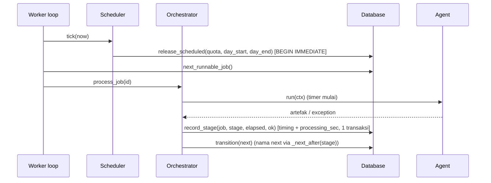

# Design Document: AI Office Improvements

## Overview

Dokumen ini merancang 11 peningkatan di `requirements.md` untuk AI Office. Desainnya mengikuti pola yang sudah ada di kode:

- **Config** tetap memakai dataclass + `_build()` di `ai_office/config.py`. Config tidak memakai pydantic. Pydantic hanya dipakai untuk kontrak data di `schemas.py`, dan nanti juga untuk profil channel.
- **State machine** tetap `JobStatus` + `ALLOWED_TRANSITIONS` + `STAGE_AGENT` di `models.py`, dengan transisi compare-and-set di `Database.transition()`.
- **Agent** tetap turunan `Agent` (`run(ctx) -> dict`). Artefaknya disimpan orchestrator ke `job.artifacts[<nama>]`.
- **Real-time** tetap memakai `EventBus` + `AgentTracker` + SSE `/api/events`.
- **Keamanan web** tetap memakai `SECURITY_HEADERS` (CSP `'self'`), `require_admin` (401), `require_csrf` (403, double-submit), dan bind `127.0.0.1`.
- **Pustaka animasi JS** tetap dites lewat `tests/js_harness.mjs` (Node + `vm`).

Prinsip desain:
1. **Logika murni dipisah dari I/O**: normalisasi topik, rencana batch, slot publikasi, pemangkasan metadata, penyamaran rahasia, kunci scene, pembagian frame, dan nama folder ditulis sebagai fungsi murni. Fungsi-fungsi ini menjadi target property-based testing.
2. **Kompatibel ke belakang**: semua kunci config baru opsional dengan default yang mempertahankan perilaku lama (Req 10.9). Cache dan render paralel mati secara default, YouTube juga mati secara default.
3. **Dependensi eksternal bisa diinjeksi**: klien YouTube, jam (clock), renderer frame, encoder, dan opener disuntikkan, sehingga test berjalan tanpa jaringan, GPU, LLM, maupun kredensial (Req 10.1).

### Ringkasan riset

- **YouTube Data API `videos.insert`**: sekarang memakai bucket kuota "Video Uploads" sendiri dengan batas default 100 panggilan per hari dan biaya 1 unit per panggilan. Kuota direset tengah malam waktu Pasifik ([videos.insert](https://developers.google.com/youtube/v3/docs/videos/insert), [quota cost](https://developers.google.com/youtube/v3/determine_quota_cost)). Konsekuensinya, `schedule.jobs_per_day` sebaiknya ≤ 100 bila YouTube aktif, dan ini cocok dengan batas validasi 1–100. `status.publishAt` hanya berlaku untuk video `private`, dan karena itu Req 5.9 memaksa `private`. `status.selfDeclaredMadeForKids` dikirim di body upload.
- **Playwright sync API tidak thread-safe**. Pola yang dianjurkan maintainer adalah satu instance `sync_playwright()` per thread ([playwright-python#623](https://github.com/microsoft/playwright-python/issues/623), [#470](https://github.com/microsoft/playwright-python/issues/470)). Render paralel memakai `ThreadPoolExecutor` dengan satu sesi Chromium per thread worker. Thread tidak berbagi objek Playwright.
- **Pustaka JS** (`core.js`): `renderFrame(plan, t)` membaca scene aktif beserta `prev`/`next` (transisi latar dan perpindahan karakter) dan waktu global `gt` (animasi idle). Artinya piksel frame bergantung pada scene itu sendiri, kedua tetangganya, dan waktu global. Kunci cache harus mencakup semuanya (lihat Kunci_Scene).
- **Dependensi baru** (dicek dengan `pip index versions`): `hypothesis 6.168.5`, `google-api-python-client 2.201.0`, `google-auth-oauthlib 1.5.0`. Tidak satu pun ada di `requirements.txt` saat ini. `hypothesis` masuk ke `requirements.txt` (bagian Testing). Paket Google masuk ke `requirements-youtube.txt` yang opsional, agar instalasi dasar tetap ringan. Semua versi dipin dengan `==`.
- **Font pixel**: **Press Start 2P** (SIL Open Font License 1.1) disertakan sebagai `web/static/fonts/PressStart2P-Regular.woff2` + `OFL.txt`. Font disajikan dari origin sendiri, sehingga lolos `default-src 'self'` tanpa perubahan CSP.

### Keputusan yang perlu diketahui user

- **Req 10.12 vs 5.20** (nilai `youtube.*` tidak valid): startup server/worker **gagal** dengan error yang menyebut kunci (10.12). `doctor` menangkap `ConfigError` dan menampilkannya sebagai error (5.20, bagian Doctor). Uploader juga memvalidasi ulang pengaturan sebelum memanggil API (5.20, bagian uploader). Jalur itu hanya bisa tercapai bila config dibangun lewat kode, misalnya di test, jadi kedua requirement tetap terpenuhi.
- **Uploader bukan sprite ke-7**: Kantor_Pixel tetap 6 Agent_Pipeline (Req 11.15). Tahap unggah tetap terlihat lewat Progres_Job (total 7) dan Lencana_Status `uploading`.

## Architecture



### State machine baru (`models.py`)

| Status | Baru? | Keterangan |
|---|---|---|
| `scheduled` | ya | Status_Menunggu_Jadwal. Tidak runnable dan tidak terminal. |
| `uploading` | ya | Tahap Pengunggah_YouTube, masuk `STAGE_AGENT` → `AgentName.UPLOADER`. |

Transisi tambahan pada `ALLOWED_TRANSITIONS`:
- `scheduled → queued` (dilepas Penjadwal)
- `delivering → uploading` (hanya dipilih orchestrator bila `youtube.enabled`)
- `uploading → done | failed`
- `failed → uploading` (otomatis, karena `FAILED` mengizinkan `*STAGE_AGENT`)

`AgentName.UPLOADER = "uploader"` ditambahkan. Dua konstanta baru:
- `PIPELINE_AGENTS` (6 agent lama, urut). Dipakai `AgentTracker.snapshot()`, Dashboard, dan `test_api` yang mengharapkan tepat 6 agent.
- `PIPELINE_STAGES = [writing, safety_review, voicing, animating, editing, delivering, uploading]`. Dipakai Progres_Job dan Timing_Tahap.

`Orchestrator.__init__` sekarang mewajibkan `PIPELINE_AGENTS` (+ `UPLOADER` bila `youtube.enabled`), tidak lagi `set(AgentName)`. Dengan begitu `conftest.make_orch` dan `build_fake_agents` tetap jalan. `build_fake_agents` juga mendapat `FakeUploader`.

### Alur orchestrator yang berubah



- `_next_after(DELIVERING)` = `UPLOADING` bila `config.youtube.enabled`, selain itu `DONE`. Untuk tahap lain tetap memakai `NEXT_AFTER_STAGE`.
- `record_stage()` menggantikan `add_processing_time()`. Satu transaksi menulis `stage_timings` dan menambah `processing_sec` dengan nilai `elapsed` yang sama, sehingga invarian Req 9.6 terjamin oleh konstruksi.
- `Orchestrator.active_job_id` diisi selama `_run_stage` berjalan. Nilai ini dipakai untuk Job_Aktif/Progres_Job.
- Semua pesan error dan log melewati `Redactor` (lihat penyamaran rahasia) sebelum disimpan.
- `_release_llm()` mendeduplikasi provider berdasarkan `(name, base_url, model)` dan hanya memanggil `release` yang ada. `GeminiProvider` tidak punya `release`, sehingga dilewati (Req 3.14, 3.15).

### Modul baru / berubah

```
ai_office/
  config.py          # + SafetyLLMConfig, ScheduleConfig, YouTubeConfig, AnimationConfig, field baru
  models.py          # + SCHEDULED, UPLOADING, UPLOADER, PIPELINE_AGENTS, PIPELINE_STAGES
  db.py              # + kolom & tabel baru, migrasi berversi, record_stage, bulk insert, slot
  orchestrator.py    # + _next_after, scheduler tick, active_job_id, progress()
  topics.py          # BARU: normalize_topic, parse_topic_lines, plan_batch (murni)
  batch.py           # BARU: BatchService (transaksional) + BatchReport
  scheduler.py       # BARU: Scheduler + plan_release (murni) + local_day_bounds
  facts.py           # BARU: Daftar_Fakta load/dump/match
  profile.py         # BARU: ChannelProfile (pydantic), load_profile, dump_profile
  redact.py          # BARU: mask_secrets + Redactor (registry rahasia + logging.Filter)
  status.py          # BARU: collect_warnings() dipakai doctor, admin API, dashboard
  youtube/
    __init__.py
    client.py        # Protocol YouTubeClient + error bertipe
    google_client.py # implementasi nyata (import lazy google-api-python-client)
    upload.py        # build_upload_body, fit_tags, next_publish_slot (murni)
  agents/
    uploader.py      # BARU: UploaderAgent
    delivery.py      # nama folder unik + alokasi atomik + marker
    safety.py        # provider terpisah + rujukan fakta + provider/model di artefak
    voice.py         # pilih suara per bahasa + blokir lisensi
    animator.py      # cache klip + render paralel
  animation/
    catalog.yaml     # entri baru, template sequence & match
    catalog.py       # + items_even untuk match
    cache.py         # BARU: ClipCache (atomik, LRU, pin)
    scene_render.py  # BARU: scene_key, split_frames, ParallelSceneRenderer
    renderer/render.py, encode.py  # sesi per thread, cancel lewat progress, concat
  editor/editor.py, music.py  # peringatan BGM kosong (1x per job)
  web/api.py         # endpoint baru + field tambahan
  web/static/        # rework pixel-art (lihat Components 11)
```

## Components and Interfaces

### 1. Katalog animasi (Req 1)

**`catalog.yaml`**, entri tambahan:
- `characters`: `kiki`, `bubu`, `pipo` (penguin biru kecil), `lala` (kelinci putih). Pose dan emosi identik dengan `kiki`.
- `backgrounds`: 6 lama + `forest`, `space`, `city`, `kitchen`, `snow` (total 11).
- `objects` (nama unik lintas kategori, Req 1.8):
  - `kendaraan`: `bus, kereta, pesawat, kapal, sepeda, truk, motor`. `mobil` tetap di `benda`.
  - `anggota_tubuh`: `mata, telinga, hidung, mulut, tangan, kaki`
  - `huruf`: `huruf_a` … `huruf_z` (26)
  - `angka`: `angka_0` … `angka_10` (11)
  - `emosi`: `wajah_senang, wajah_sedih, wajah_marah, wajah_kaget, wajah_takut`
- `templates`:
  - `sequence: {items: [2, 5]}`
  - `match: {items: [4, 8], pairs: true}`

**`catalog.py`**: `TemplateSpec.items_even: bool` (dari `pairs: true`). `Catalog.from_dict` menolak nama objek duplikat lintas kategori (`ValueError`). `scene_errors` menambah pesan untuk jumlah ganjil, misalnya `scene 3: template 'match' butuh jumlah items genap 4-8, bukan 5`. Pesan ini menyebut nomor scene, template, jumlah, dan batas (Req 1.15). `prompt_listing()` menyebut aturan pasangan.

**`schemas.py`**: `SceneParams.items` `max_length` dinaikkan dari 2 ke 8. `script_json_schema` juga memakai `maxItems: 8`. Validasi per template tetap dilakukan katalog.

**Pustaka JS**:
- `characters.js`: `pipo` dan `lala` dibuat lewat `makeChar({...})` (warna/telinga berbeda), dengan pose/emosi bersama.
- `backgrounds.js`: 5 fungsi latar baru.
- `objects.js`:
  - kendaraan, anggota tubuh, dan emosi digambar sebagai SVG vektor.
  - `huruf_*` dan `angka_*` dihasilkan dalam loop: ubin bundar + `A.bigText(glyph)`. Huruf memakai kapital `A`–`Z`.
- `templates.js`:
  - `T.sequence`: N objek berjajar (1 baris untuk ≤3, 2 baris untuk 4–5). Objek ke-i pop-in pada `0.4 + i·per` dengan `A.numberBadge(i+1)`. Tidak ada efek keluar sebelum `ctx.exit`, jadi semua objek tetap terlihat sampai akhir scene (Req 1.10).
  - `T.match`: K = N/2 pasangan. Kolom kiri berisi item ganjil. Kolom kanan berisi item genap dengan urutan diputar satu posisi secara deterministik, agar garis menyilang. Semua objek pop-in pada `[0.2, 0.8]` detik. Garis ke-k digambar (stroke-dashoffset dari 1 ke 0) pada `t_k = 0.9 + k·per`, dengan `per = (dur − 0.9 − EXIT_SEC − 0.3)/K`, sehingga garis terakhir lengkap sebelum `dur − EXIT_SEC` (Req 1.12).
- `validatePlan`: pesannya sudah berformat `scene <id>: <jenis> tidak ada: <nama>`. Format ini dipertahankan dan menjadi dasar Req 1.18. `render_frames` sudah menolak plan sebelum frame pertama, dan cache menulis lewat file sementara, sehingga tidak ada klip parsial.

**Test kecocokan (Req 1.19, 1.20)**: helper `catalog_diff(category, catalog_names, js_names) -> str | None` menghasilkan laporan `kategori=objects; hanya di Katalog=[...]; hanya di Pustaka_JS=[...]`. `test_catalog_matches_js_library` memanggilnya untuk karakter, pose (per karakter), emosi (per karakter), latar, objek, warna, dan template, lalu memanggil `pytest.fail(laporan)`.

### 2. Peringatan musik latar & agregator status (Req 2, 7.3–7.5, 8.7–8.13, 5.19, 11.61)

**`editor/music.py`**: `BGM_EXTS = (".mp3", ".wav", ".m4a", ".ogg")` sesuai definisi File_Musik di glossary. `.flac`/`.aac` lama dihapus dari deteksi agar definisi kosong konsisten. `is_bgm_empty(bgm_dir) -> bool` hanya memindai file langsung di folder.

**`status.py`**:

```python
@dataclass(frozen=True)
class Warning:
    code: str            # bgm_empty | voice_license | profile_invalid | profile_empty |
                         # profile_missing | profile_lang_mismatch | voice_lang_mismatch |
                         # youtube_credentials_missing
    level: str           # INFO | WARNING | ERROR
    message: str         # teks Bahasa Indonesia, sudah menyebut path/kunci terkait
    banner: bool         # tampil di Banner_Peringatan (Req 11.61)

def collect_warnings(config: AppConfig, profile: ProfileResult | None = None) -> list[Warning]
def public_flags(config: AppConfig) -> dict[str, bool]   # {"music_unavailable": ...}
```

- Fungsi ini dihitung ulang di setiap panggilan, tanpa cache, sehingga menambah File_Musik langsung terlihat tanpa restart (Req 2.6).
- `bgm_empty` hanya muncul bila `music.enabled` true (Req 2.9). Pesannya berisi `config.resolve(music.bgm_dir)` dan `data/bgm/README.md`.
- `voice_license` muncul bila `content.monetized` dan `voice.engine == "xtts"`. Pesannya menyebut CPML non-komersial dan `edge-tts`.
- `voice_lang_mismatch` muncul bila engine `edge-tts` dan prefiks lokal suara terpilih berbeda dari `content.language`.
- `youtube_credentials_missing` muncul bila `youtube.enabled` dan file token/client secret tidak ada.
- Item `banner=True` adalah `bgm_empty`, `voice_license`, `profile_invalid`/`profile_empty`, dan `youtube_credentials_missing`.

**Konsumen**:
- `cmd_doctor` mencetak semua item per level. Exit code tetap hanya ditentukan oleh ketersediaan agent, jadi warning tidak menyebabkan kegagalan (Req 2.3).
- `GET /api/admin/warnings` mengembalikan item `banner`.
- `GET /api/status` menambah `music_unavailable` (boolean saja, tanpa path, Req 11.36).

**Editor**: bila `music.enabled` dan BGM kosong, Editor memanggil `ctx.log_once("bgm_empty", msg, level="WARNING")`. `AgentContext.log_once` baru diimplementasikan dengan `db.has_log(job_id, message)`, sehingga retry tidak menggandakan log (Req 2.7). Video tetap dibuat tanpa musik (perilaku lama, Req 2.8).

**Dokumentasi**: `data/bgm/README.md` (sudah di-track git) dan README utama mencantumkan sumber musik (YouTube Audio Library, Pixabay Music), format, dan lokasi (Req 2.10).

### 3. Penasihat Keamanan: LLM terpisah + Daftar_Fakta (Req 3)

**Config**:

```python
@dataclass
class SafetyLLMConfig:            # semua opsional; None = ikut bagian `llm`
    provider: str | None = None
    model: str | None = None
    base_url: str | None = None
    timeout_sec: float | None = None

@dataclass
class SafetyConfig:
    rubric_file: str = "safety_rubric.yaml"
    temperature: float = 0.2
    llm: SafetyLLMConfig | None = None
    facts_file: str | None = None

AppConfig.effective_safety_llm() -> LLMConfig
```

`effective_safety_llm()` memakai `dataclasses.replace(self.llm, ...)` dengan field non-None dari `safety.llm`. Bila provider efektifnya `gemini`, `model` dipetakan ke `gemini_model`. `validate()` memeriksa provider ∈ `LLM_PROVIDERS` (pesan menyebut nilai dan daftar) dan `timeout_sec` angka dalam 1..3600 (Req 3.3, 3.4).

**`build_agents`**: provider writer = `build_provider(config.llm)`. Provider safety = `build_provider(config.effective_safety_llm())`, kecuali hasilnya identik dengan `config.llm`. Dalam kasus itu instance yang sama dipakai bersama, sehingga perilaku lama identik (Req 3.2). `SafetyAgent.is_available()` memakai provider-nya sendiri, sehingga tracker menandai `offline` atau online lewat mekanisme `refresh_availability` yang sudah ada (30 detik, Req 3.12, 3.13).

**`facts.py`**:

```python
@dataclass(frozen=True)
class FactEntry:
    topic: str
    facts: tuple[str, ...]

@dataclass(frozen=True)
class FactsLoad:
    entries: tuple[FactEntry, ...]
    error: str | None          # None = valid

def parse_facts(text: str) -> list[FactEntry]          # raise FactsError(alasan)
def dump_facts(entries: Sequence[FactEntry]) -> str     # YAML, urutan dipertahankan
def load_facts(path: Path) -> FactsLoad                 # tidak pernah raise
def match_facts(entries, topic: str) -> list[str]       # semua fakta dari entri yang cocok
```

Format file:

```yaml
facts:
  - topic: "learn colors"
    facts: ["Red and yellow make orange.", "The sky looks blue on a clear day."]
```

Pencocokan memakai `normalize_topic` (`topics.py`) di kedua sisi, dengan kesamaan persis. Fakta disisipkan di pesan user review sebagai blok `RUJUKAN FAKTA TERVERIFIKASI`, dengan log jumlah fakta. Ada tiga cabang lain:
- tidak ada entri yang cocok → log INFO (Req 3.7)
- `facts_file` tidak dikonfigurasi → tanpa log (Req 3.8)
- file tidak ada, tidak bisa dibaca, gagal parse, atau berisi entri tidak valid → log WARNING berisi path + alasan, lalu review tetap berjalan (Req 3.9)

**Artefak**: `SafetyReport` mendapat `llm_provider: str | None = None`, `llm_model: str | None = None`, `facts_used: int = 0`. Default `None` menjaga kompatibilitas artefak lama dan `FakeSafety`. Log `Meninjau naskah dengan <provider>:<model>` sudah ada.

**Kegagalan LLM (Req 3.11)**: `LLMError` atau timeout di-wrap menjadi `AgentError(f"Penasihat Keamanan gagal memanggil {provider}:{model}: ...")`. Orchestrator menandai `failed` dengan `failed_stage=safety_review`. Tidak ada transisi ke tahap berikutnya.

### 4. Batch & Penjadwal (Req 4)

**`topics.py`** (murni):

```python
MAX_LINES = 500
MAX_TOPIC_LEN = 200

def normalize_topic(s: str) -> str:
    # 1) lower()  2) buang [\W_] (termasuk spasi) di awal/akhir  3) rapatkan spasi internal
    s = re.sub(r"^[\W_]+|[\W_]+$", "", s.lower())
    return " ".join(s.split())

def parse_topic_lines(text: str) -> list[str]           # text.splitlines()

@dataclass(frozen=True)
class LineOutcome:
    line_no: int
    topic: str
    kind: Literal["created", "duplicate", "empty", "too_long"]
    duplicate_of: int | None = None      # id job lama, atau None jika duplikat di dalam daftar

def plan_batch(lines, existing: Mapping[str, int], allow_duplicates: bool) -> list[LineOutcome]
```

Pada `plan_batch`, tiap baris diklasifikasikan berurutan:
- `empty`: hasil normalisasi kosong
- `too_long`: panjang hasil normalisasi > 200 (tetap dilewati walau `allow_duplicates`)
- `duplicate`: tanpa `allow_duplicates`, bila sudah terlihat di daftar atau ada di `existing` (normalized → id job berstatus selain `failed`/`rejected`)
- `created`: selain itu

Tepat satu outcome dihasilkan per baris, sehingga jumlah keempat kelompok sama dengan jumlah baris (Req 4.7).

Topik job yang disimpan adalah baris asli yang sudah di-`strip()`, sedangkan `normalized_topic` disimpan di kolom baru.

**`batch.py`**:

```python
@dataclass
class BatchReport:
    created: list[int]
    duplicates: list[dict]     # {"line": n, "topic": t, "duplicate_of": id|None}
    empty: int
    too_long: list[int]        # nomor baris

class BatchError(ValueError): ...

class BatchService:
    def submit_text(self, text: str, allow_duplicates: bool, source: str) -> BatchReport
    def submit_file(self, path: Path, allow_duplicates: bool) -> BatchReport
```

`submit_file` membaca bytes, lalu decode `utf-8-sig` (strict). Error decode, file tidak ada, atau jumlah baris > 500 menghasilkan `BatchError`. Pada `submit_text`, validasi > 500 baris dilakukan sebelum menulis apa pun. Lalu `db.create_batch_jobs(...)` dijalankan dalam satu `BEGIN IMMEDIATE`: membaca `existing`, menjalankan `plan_batch`, dan menyisipkan semua job. Jadi semua job dibuat atau tidak sama sekali, dan aman dari CLI + panel yang berjalan bersamaan.

Status awal job batch adalah `scheduled` bila `schedule.jobs_per_day` diisi. Bila tidak, statusnya `queued` dengan `released_at = now` (Req 4.12). Setiap job mendapat `batch_id` (UUID4 hex).

**`scheduler.py`**:

```python
def local_day_bounds(now: datetime) -> tuple[float, float]   # epoch 00:00 lokal & 00:00 besok
def plan_release(quota: int, released_today: int, waiting_ids: Sequence[int]) -> list[int]
    # waiting_ids sudah urut created_at,id; hasil = prefix sepanjang max(0, quota - released_today)

class Scheduler:
    def __init__(self, config, db, bus, clock: Callable[[], datetime] = local_now)
    def tick(self) -> list[int]
```

`tick()` memanggil `db.release_scheduled(quota, day_start, day_end, now)`. Dalam satu `BEGIN IMMEDIATE`, fungsi ini menghitung `released_at ∈ [day_start, day_end)` untuk job batch, memilih job `scheduled` tertua, lalu men-transisi-kannya ke `queued` dengan `released_at=now` lewat UPDATE bersyarat `status='scheduled'`. Hasilnya tidak ada duplikasi dan kuota tidak terlampaui, juga setelah restart (Req 4.14), karena hitungannya selalu dari DB.

`tick()` dipanggil di awal `start_worker()` dan di setiap putaran `_worker_loop`. Bila `jobs_per_day` None, semua `scheduled` yang tersisa (misalnya config baru diubah) langsung dilepas. Event `job_status` dipublikasikan untuk setiap job yang dilepas.

**CLI**: `python -m ai_office.cli batch <file> [--allow-duplicates]` mencetak laporan. Exit code 0 bila berhasil, 2 bila `BatchError`, dengan pesan ke stderr (Req 4.15).

**API**: `POST /api/admin/batch` (require_admin + require_csrf, Req 4.17), body `{"topics": str, "allow_duplicates": bool}`. `topics` dibatasi 200.000 karakter (lalu 400). Lebih dari 500 baris → 400 dengan pesan `maksimal 500 baris` (Req 4.16). Respons berisi `BatchReport`.

### 5. Pengunggah YouTube (Req 5)

**Config**:

```python
@dataclass
class YouTubeConfig:
    enabled: bool = False
    privacy: str | None = None             # None => "private"
    publish_at: str | None = None          # ISO 8601 dengan zona, mis. 2025-01-01T09:00:00+07:00
    publish_interval_minutes: int | None = None   # None => 1440
    credentials_dir: str = "data/youtube"  # di-gitignore (data/); override env AI_OFFICE_YOUTUBE_DIR
    client_secret_file: str = "client_secret.json"
    token_file: str = "token.json"
```

`validate()` memeriksa `privacy ∈ {private, unlisted, public}`, `publish_at` bisa di-parse `datetime.fromisoformat` dengan `tzinfo`, dan `publish_interval_minutes ∈ [15, 10080]`. Bila gagal, muncul `ConfigError` yang menyebut kunci. Fungsi validasi yang sama (`validate_youtube(cfg) -> list[str]`) dipakai ulang oleh uploader sebelum memanggil API (Req 5.20).

**`youtube/client.py`**:

```python
class YouTubeError(Exception): ...
class YouTubeQuotaError(YouTubeError): ...     # reason quotaExceeded / uploadLimitExceeded / rateLimitExceeded(403)
class YouTubeAuthError(YouTubeError): ...      # 401, invalid_grant, token tidak ada
class YouTubeNetworkError(YouTubeError): ...   # httplib2/socket/timeout/5xx

class YouTubeClient(Protocol):
    def upload(self, video_path: Path, body: dict[str, Any]) -> str: ...   # -> video id
    def secrets(self) -> list[str]: ...         # nilai Rahasia_OAuth untuk Redactor
```

**`youtube/google_client.py`**: `GoogleYouTubeClient.from_files(client_secret, token)`. Modul ini import lazy `googleapiclient`, `google.oauth2.credentials`, dan `google.auth.transport.requests`. Token di-refresh bila kedaluwarsa dan ditulis ulang atomik (temp + `os.replace`). Upload memakai `MediaFileUpload(resumable=True)` dengan loop `next_chunk()`. `HttpError` dipetakan ke error bertipe di atas.

Otorisasi pertama dilakukan lewat `python -m ai_office.cli youtube-auth`, yang menjalankan `InstalledAppFlow.run_local_server(host="127.0.0.1")` dengan scope `https://www.googleapis.com/auth/youtube.upload`.

**`youtube/upload.py`** (murni):

```python
TITLE_MAX, DESC_MAX, TAGS_MAX = 100, 5000, 500

def tags_length(tags) -> int     # sum(len(t) + (2 if " " in t else 0)) + (len(tags) - 1) koma
def fit_tags(tags: Sequence[str]) -> list[str]
    # bersihkan '#', buang kosong, lalu buang dari belakang sampai tags_length <= 500
def build_upload_body(meta: VideoMetadata, privacy: str,
                      publish_at: datetime | None) -> dict
    # snippet{title[:100], description[:5000], tags, categoryId "27" (Education)}
    # status{privacyStatus, selfDeclaredMadeForKids: True, publishAt?}
def next_publish_slot(base: datetime, interval_min: int, now: datetime,
                      used: Collection[datetime]) -> datetime
    # k terkecil >= 0: slot = base + k*interval; slot >= now + 60 menit; slot not in used
```

`selfDeclaredMadeForKids: True` di-hardcode di `build_upload_body`. Fungsi ini tidak menerima parameter yang bisa mengubahnya (Req 5.6). Bila `publish_at` diisi, `privacyStatus` dipaksa `private` (Req 5.9).

**`agents/uploader.py`**: `UploaderAgent(config, client_factory)`. Alur `run(ctx)`:
1. Bila `ctx.artifacts["uploader"].video_id` atau `workdir/youtube_result.json` sudah ada, upload dilewati dan hasil itu dikembalikan (Req 5.18). File di workdir ditulis **segera** setelah API mengembalikan id, sebelum orchestrator menyimpan artefak. Ini menutup celah "upload sukses tapi crash sebelum artefak tersimpan".
2. `validate_youtube` gagal → `AgentError` tanpa memanggil client.
3. Baca `editor.metadata_file` (`metadata.json`) dan video dari `Folder_Tujuan` milik artefak `delivery`, dengan fallback ke workdir.
4. Bila `publish_at` diisi, `db.reserve_publish_slot(job_id, base, interval, now)` memakai tabel `youtube_slots(slot_ts UNIQUE, job_id UNIQUE)` dalam `BEGIN IMMEDIATE`. Slot milik job yang sama dipakai ulang bila masih ≥ now+60 menit. Bila tidak, slot diganti.
5. `client.upload(...)`. Bila `YouTubeQuotaError`, muncul `AgentError("kuota habis")`. Error lain di-mask dengan Redactor lalu menjadi `AgentError`. Orchestrator menandai `failed`/`failed_stage=uploading`. Artefak sebelumnya tidak disentuh, dan worker lanjut (pola lama).
6. Artefak yang dihasilkan: `{video_id, url: "https://youtu.be/<id>", privacy, publish_at}`.

Retry job yang gagal di `uploading` → `failed_stage=uploading`, jadi hanya tahap unggah yang dijalankan ulang. Artefak `delivery` tidak berubah (Req 5.17).

**Doctor**: menampilkan peringatan bila kredensial tidak ada (path yang diharapkan), dan menampilkan error validasi `youtube.*` saat `load_config` gagal.

### 6. Folder pengiriman unik (Req 6)

```python
def folder_base_name(date_utc: datetime, job_id: int, title: str) -> str
    # f"{date:%Y%m%d}_{job_id}_{slugify(title)}"
def allocate_dest(root: Path, base: str, job_id: int) -> Path
```

- `allocate_dest` mencoba `base`, `base-2`, …, `base-100` dengan `Path.mkdir(exist_ok=False)`. Operasi ini atomik terhadap pembuat folder lain. Setelah folder dibuat, file marker `.ai_office_job` (berisi id job) ditulis.
- Bila nama sudah ada dan marker-nya berisi id job yang sama, folder itu dipakai ulang. Ini menutup kasus gagal di tengah sebelum artefak tercatat (Req 6.3, 6.6).
- Semua nama terpakai → `AgentError` tanpa menimpa apa pun (Req 6.5).
- Retry dengan `artifacts.delivery.dest_dir` tercatat → folder itu dipakai. Bila sudah terhapus, folder dibuat ulang dengan `mkdir(parents=True, exist_ok=True)` dan semua file disalin ulang (Req 6.6, 6.7).
- `PermissionError`/`OSError` saat membuat folder di `delivery.dest_dir` → `AgentError` dengan path. Artefak tidak dicatat (Req 6.8).
- Test lama `dest.name.endswith("_lets-learn-colors")` tetap lulus.

### 7. Lisensi suara & suara per bahasa (Req 7)

**Config**: `ContentConfig.monetized: bool = False`, `VoiceConfig.voices: dict[str, str] = {"id": "id-ID-GadisNeural", "en": "en-US-AnaNeural"}` (via `default_factory`), dan `VoiceConfig.block_noncommercial: bool = False`. `validate()` memastikan boolean asli dan `voices` adalah mapping `str → str` non-kosong (Req 7.11). `_build` menolak `bool` untuk field `int` dan menerima `dict` hanya untuk field bertipe `dict`.

```python
def resolve_voice(voice_cfg: VoiceConfig, language: str) -> tuple[str, bool]   # (nama, fallback?)
```

`VoiceAgent.run`:
1. Bila `monetized and block_noncommercial and engine == "xtts"`, muncul `AgentError("XTTS-v2 berlisensi CPML non-komersial ... pakai voice.engine: edge-tts")` sebelum `synthesize` pertama (Req 7.6).
2. Untuk engine `edge-tts`, pakai `self.engine.with_voice(name)` (method baru `EdgeTTSEngine.with_voice` yang mengembalikan instance baru), dengan `name` dari `resolve_voice(cfg, job.language)`. Bila terjadi fallback ke `voice.voice`, panggil `ctx.log_once("voice_fallback", ...)` WARNING (Req 7.9).
3. CLI `voice-file`/`build-file` memakai `script.language`.

### 8. Profil channel (Req 8)

**`profile.py`**:

```python
class ChannelProfile(BaseModel):          # extra="ignore"
    channel_name: str | None = Field(None, max_length=100)
    niche: str | None = Field(None, max_length=100)
    tone: str | None = Field(None, max_length=100)
    language: Literal["id", "en"] | None = None
    target_age_group: str | None = None   # validator: ^\d{1,2}-\d{1,2}$, a <= b, 0..99
    recurring_phrases: list[NonEmptyStr200] = Field(default_factory=list, max_length=50)
    avoid_topics: list[NonEmptyStr200] = Field(default_factory=list, max_length=50)
    example_topics: list[NonEmptyStr200] = Field(default_factory=list, max_length=50)

@dataclass(frozen=True)
class ProfileResult:
    status: Literal["ok", "missing", "parse_error", "invalid"]
    profile: ChannelProfile | None
    errors: list[str]                 # satu pesan per field: "<field>: <alasan>"

def load_profile(path: Path) -> ProfileResult          # tidak pernah raise, tidak menulis file
def dump_profile(p: ChannelProfile) -> str             # yaml.safe_dump(sort_keys=False)
def profile_display_name(result: ProfileResult) -> str # "AI Office" bila tidak ok / kosong
```

- Error pydantic dikelompokkan per `loc[0]` agar keluar satu pesan per field (Req 8.7).
- `WriterAgent` hanya memakai profil bila `status == "ok"` (Req 8.8, 8.12, 8.13).
- `run.py`/`bootstrap` mencetak error profil ke log startup.
- File `content_profile.yaml` hanya dibaca, tidak pernah ditulis atau disalin oleh kode (Req 8.3).
- `content_profile.example.yaml` baru berisi semua field terisi. Sebuah test memvalidasinya (Req 8.1, 8.2).

### 9. Timing, cache klip, render paralel (Req 9)

**Timing**:
- `db.record_stage(job_id, stage, duration, ok)` (lihat Architecture).
- `db.get_stage_timings(job_id)` urut `id`.
- `db.timing_summary(n)`: rata-rata dan jumlah sampel per stage dari entri `ok=1` milik N job `done` dengan `finished_at` terbaru.
- CLI `timings [--last N]` (1..1000, default 20). Bila tidak ada job done: `Belum ada job selesai.`, exit 0.
- Admin detail job menambah field `stage_timings`.

**Kunci_Scene (`animation/scene_render.py`)**:

```python
RENDERER_VERSION = "1"            # dinaikkan manual bila render.py/encode.py berubah perilaku

def library_hash() -> str          # sha256(stage.html + semua JS_FILES), di-cache per proses
def split_frames(plan, fps) -> list[list[float]]
    # frame_times(total, fps) dipartisi berurutan per scene: frame t masuk scene i
    # bila start_i <= t < start_i + dur_i; sisa ekor masuk scene terakhir
def scene_key(plan, index, frame_times_i, *, width, height, fps, lib_hash, renderer_sig) -> str
    # sha256(canonical_json({
    #   "scene": plan.scenes[i], "prev": plan.scenes[i-1]|None, "next": plan.scenes[i+1]|None,
    #   "plan": {k: v for k in plan if k != "scenes"},
    #   "times": frame_times_i, "w": width, "h": height, "fps": fps,
    #   "lib": lib_hash, "renderer": renderer_sig}))
```

- `canonical_json` memakai `json.dumps(sort_keys=True, separators=(",", ":"), ensure_ascii=False)`, dan float plan sudah dibulatkan 3 desimal oleh `build_plan`.
- `renderer_sig = f"{RENDERER_VERSION}|{encoder}|{encode_args}"`. Encoder ikut dalam kunci karena klip cache digabung tanpa encode ulang. Klip NVENC dan libx264 tidak boleh tercampur.
- Pembagian frame tidak memengaruhi piksel, karena setiap frame tetap dirender dengan **plan penuh** pada waktu global `t`. Kunci mencakup semua yang dibaca `renderFrame` untuk rentang waktu itu.

**`animation/cache.py`**:

```python
class ClipCache:
    def __init__(self, root: Path, max_bytes: int | None)
    def get(self, key) -> Path | None      # None bila tidak ada/0 byte/tak terbaca (entri dihapus)
    def put(self, key, src: Path) -> Path  # os.replace(temp di root/tmp -> root/ab/<key>.mp4)
    def pin(self, keys) / unpin(self, keys)
    def evict(self) -> list[str]           # LRU berdasarkan mtime, lewati yang di-pin
```

- `get` yang berhasil memanggil `os.utime` (mtime = terakhir dipakai) dan membuka file untuk membaca 1 byte (Req 9.18).
- `put` menulis temp di volume yang sama lalu `os.replace`. Bila target sudah ada (`PermissionError` di Windows karena file sedang terbuka), temp dihapus dan target dipakai.
- Evict berjalan setelah setiap `put` bila `max_bytes` diisi (Req 9.11).
- Pin adalah set in-process dengan lock. Batasannya: proses CLI `build-file` terpisah yang berjalan bersamaan tidak berbagi pin. Ini didokumentasikan.

**`AnimatorAgent.run` (jalur baru)**: jalur lama (render semua frame lalu sekali encode) dipertahankan **persis** bila `cache.enabled == false` dan `parallel_scenes == 1` (Req 9.16, 10.9). Jalur baru:
1. `chunks = split_frames(plan, fps)`, `keys = [scene_key(...)]`, lalu `cache.pin(keys)`.
2. Untuk setiap scene: `cache.get(key)` → hit. Bila miss, scene masuk antrean render.
3. `ParallelSceneRenderer(renderer, encoder, workers=N).render(misses, cancel)`. Setiap tugas merender frame chunk-nya ke `tmp/<uuid>/`, meng-encode ke `tmp/<uuid>.mp4`, lalu `cache.put` (atau, tanpa cache, memindahkan ke `workdir/scenes/scene_<i>.mp4`).
4. `concat_clips(paths, workdir/animation.mp4)` memakai demuxer ffmpeg concat `-c copy`.
5. Log `Cache: <hit> scene dari cache, <miss> scene dirender baru` dicatat di blok `finally`, sehingga tetap tercatat saat gagal (Req 9.10).
6. `cache.unpin(keys)`.

**`ParallelSceneRenderer`**:
- `ThreadPoolExecutor(max_workers=N)`. Setiap thread memakai `renderer.thread_session()` (thread-local: `sync_playwright()` + browser + page dengan plan dimuat sekali per thread, Req 9.12).
- Pengiriman tugas menjaga `min(N, sisa)` tugas aktif.
- `cancel: threading.Event`. Callback `progress` dipanggil **setiap frame** (sebelumnya setiap 15 frame) dan melempar `RenderCancelled` bila `cancel` aktif. Signature `render_frames(plan, times, out_dir, progress)` tidak berubah, sehingga `FakeRenderer` di test tetap kompatibel.
- `encode_frames_to_mp4` mendapat parameter opsional `cancel`. Subprocess ffmpeg dijalankan dengan `Popen` dan di-`terminate()` lalu `kill()` setelah 2 detik bila `cancel` aktif.
- Kegagalan pertama → `cancel.set()`, tidak ada tugas baru, tunggu maksimal 10 detik, lalu `AgentError(f"Render scene {i} gagal: ...")` (Req 9.14).
- Folder temp scene yang gagal dihapus. Klip lengkap scene lain yang sudah `put` tetap ada (Req 9.15).

**Config**:

```python
@dataclass
class AnimationCacheConfig:
    enabled: bool = False
    dir: str = "data/cache/clips"
    max_size_mb: int | None = None          # 1..1_000_000

@dataclass
class AnimationConfig:
    cache: AnimationCacheConfig = field(default_factory=AnimationCacheConfig)
    parallel_scenes: int = 1                # 1 (berurutan) atau 2..16
```

### 10. Kompatibilitas & keamanan (Req 10)

- Endpoint admin baru memakai `dependencies=[Depends(require_admin)]`. Endpoint yang mengubah data menambah `Depends(require_csrf)` (Req 10.3, 10.4). Sebuah test parametrik mengiterasi semua route `/api/admin/*` dari `app.routes`, sehingga endpoint baru otomatis ikut teruji tanpa sesi (401) dan tanpa CSRF (403).
- `_build()` diperluas:
  - mendukung `X | None` untuk dataclass bersarang (`safety.llm`) dan skalar
  - memeriksa `int`/`float`/`str`/`bool` secara ketat (bool bukan int)
  - menerima `dict` untuk field bertipe `dict[...]`
  - menolak kunci tidak dikenal (perilaku lama)
- `load_config` gagal → `run.py` keluar sebelum server dan worker dimulai (Req 10.12).
- `config.yaml` di repo mendapat bagian baru dengan komentar Bahasa Indonesia, dan README mendapat tabel pengaturan baru (Req 10.11).

### 11. Rework web pixel-art (Req 11)

**Struktur file `web/static/`**:

```
index.html, admin.html        # tanpa inline style/script/handler; tanpa aset eksternal
style.css                     # Token_Desain (:root) + komponen; @font-face lokal
common.js                     # el(), fmtDuration(), STATUS_LABELS, badge(), live(), fetchJSON
app.js                        # Dashboard: SSE, Top_Bar, Bottom_Bar, kartu, daftar video
office.js                     # Kantor_Pixel (canvas): render loop, scaling, reduced motion
office_model.js               # MURNI: layout peta, frame sprite per status, teks status, progres
sprites.js                    # MURNI: peta pixel (array string) + palet tiap sprite/perabot
admin.js                      # Panel_Admin: router seksi, form, detail, banner, error/timeout
icons/*.svg                   # ikon pixel 16x16 (<rect>, shape-rendering="crispEdges")
fonts/PressStart2P-Regular.woff2, fonts/OFL.txt
```

**Token_Desain** (`:root` di `style.css`, satu-satunya tempat nilai literal, Req 11.4):

| Token | Nilai | Catatan |
|---|---|---|
| `--c-bg` | `#0F1A2E` | HSL ≈ 219°, 12% |
| `--c-panel` | `#16243F` | HSL ≈ 220°, 17% |
| `--c-border` | `#2E4A7A` | lebih terang dari panel |
| `--c-primary` | `#FFD43B` | satu-satunya warna utama |
| `--c-accent-green` | `#5CDB6D` | isian bar progres |
| `--c-accent-pink` | `#FF8FC7` | |
| `--c-accent-cyan` | `#4FD1FF` | indikator fokus |
| `--c-text` | `#E8EEF9` | |
| `--c-text-muted` | `#A9B7D0` | |
| `--c-floor` | `#C9CED6` | ubin lantai abu-abu terang (canvas membaca token via `getComputedStyle`) |
| `--space-1..6` | `4px … 32px` | |
| `--radius` | `0` / `--radius-sm: 2px` | sudut tajam bergaya pixel |
| `--font-pixel` | `"Press Start 2P", ui-monospace, "Cascadia Mono", Consolas, monospace` | Req 11.7 |
| `--font-body` | `system-ui, "Segoe UI", Roboto, sans-serif` | ukuran ≥ 14px untuk teks isi |

Panel bergaya pixel memakai `border: 4px solid var(--c-border)` + `box-shadow` bertangga (tanpa blur). Lencana_Status memakai `.badge--<status>` dengan latar khas per status, dan label teks diambil dari `STATUS_LABELS`. Contohnya `awaiting_script_approval` → "Gerbang 1: naskah" dan `scheduled` → "Menunggu jadwal" (Req 11.50).

**Dashboard (`index.html`)**, urut dari atas ke bawah:
- `<header class="topbar">`: nama channel (Font_Pixel), mode, indikator koneksi
- `<section class="office">`: `<canvas id="office" role="img" aria-describedby="office-list">` + `<ul id="office-list" class="sr-only">`
- `<section class="bottombar">`: progressbar + penghitung
- `<section class="cards">`
- `<section class="videos">`
- `<div id="live" role="status" aria-live="polite" class="sr-only">`

**Kantor_Pixel (`office.js` + `office_model.js` + `sprites.js`)**:
- **Dunia logis** 320×180 px (ubin 16 px, 20×11 ubin): dinding atas 2 ubin, lantai ubin abu-abu terang, dan 6 meja (3 kolom × 2 baris), masing-masing dengan monitor + kursi, plus tanaman, rak buku, dispenser air, dan sofa (Req 11.14).
- **Skala**: `canvas.width = cssWidth × dpr` dan `height = width × 9/16` (aspek tetap, Req 11.21). `ctx.imageSmoothingEnabled = false`, dan CSS `image-rendering: pixelated` (Req 11.10). Sprite digambar sebagai `fillRect` per pixel logis dengan `scale = canvas.width / 320`, dibulatkan ke bawah ke 0,5 terdekat agar tepi tajam. Sisa ruang di-letterbox dengan warna `--c-bg`.
- **Label**: nama (Req 11.15) dan status teks (`STATE_LABEL`: "Sedang kerja", "Santai", "Offline", "Baru selesai", Req 11.20) digambar di plat gelap `--c-panel` dengan teks `--c-text` (kontras ≥ 4.5:1). Teks memakai Font_Pixel dengan ukuran `max(8 px logis × scale, 9 px CSS × dpr)`. Label dipecah per kata bila lebih lebar dari lebar sel meja ("Penasihat / Keamanan"). Canvas menunggu `document.fonts.load('8px "Press Start 2P"')` sebelum menggambar teks.
- **Frame sprite** dipilih oleh `spriteFrame(state, tMs, reducedMotion)` yang murni:
  - `working`: 2 frame mengetik bergantian 250 ms
  - `idle`: pose diam
  - `offline`: palet redup (desaturasi + alpha 0.45)
  - `just_done`: pose senang + ikon bintang pixel berkedip
  - reduced motion: selalu frame 0 dan tanpa kedip (Req 11.16–11.19, 11.23)
- **Loop**: `requestAnimationFrame` hanya berjalan bila `!reducedMotion` (`matchMedia('(prefers-reduced-motion: reduce)')` dengan listener `change`). Bila reduced motion, gambar ulang terjadi hanya saat state berubah atau resize.
- **Padanan teks**: `#office-list` di-render ulang di `setStates()` dari data yang sama, berisi `"<Nama>: <Status>"` (Req 11.22).

**Bottom_Bar**: `<div role="progressbar" aria-valuemin="0" aria-valuemax="<total>" aria-valuenow="<done>" aria-valuetext="Progres job #12 3/6">`.
- Isian bar lebarnya `done/total` dan diatur lewat `element.style.width`. Ini properti CSSOM yang diset dari skrip dan **bukan** atribut `style` inline di HTML, jadi tidak dibatasi CSP `style-src 'self'` (CSP hanya memblokir atribut/elemen style dari markup, sedangkan perubahan CSSOM dari skrip yang diizinkan tetap boleh).
- Tanpa Job_Aktif: label "Tidak ada job aktif" dengan `aria-valuenow="0"`.
- Penghitung "Agent Bekerja x/6".

**Data publik**: `GET /api/status` (kontrak lama + field baru):

```json
{"summary": {..., "scheduled_jobs": 0},
 "agents": [...6...],
 "channel_name": "AI Office",
 "music_unavailable": false,
 "progress": {"job_id": 12, "done": 3, "total": 6} | null}
```

`progress()` = `PIPELINE_STAGES.index(status)` dari Job_Aktif, dengan total 6 atau 7. Snapshot SSE memakai builder yang sama (`public_status()`). Event `job_status`/`agent_state` membuat Dashboard melakukan fetch `/api/status`, dengan debounce 200 ms (Req 11.24, 11.29, 11.31).

**Reconnect SSE**: `EventSource` dibuat manual. `onerror` → `close()`, lalu indikator "Koneksi terputus" muncul dan reconnect dijalankan dengan backoff 1, 2, 4, 8, 10, 10… detik. Timer 10 detik sejak halaman dimuat menampilkan indikator bila belum `onopen`. `onopen` → sembunyikan indikator, lalu `refreshAll()` (Req 11.37).

**Daftar video**: `GET /api/jobs?status=done&limit=20`. Parameter `status` adalah tambahan opsional. Durasi ditampilkan `m:ss` lewat `fmtDuration`. Daftar kosong → empty state.

**Panel_Admin (`admin.html`)**:
- `<header class="topbar">`: brand, `<label for="job-select">` + `<select id="job-select">`, `<button id="menu-toggle" aria-expanded aria-controls="sidebar">Menu</button>`, avatar pixel `` + teks "Admin".
- `<nav id="sidebar">`: `<a href="/">` Kantor, lalu `<button data-section="create|batch|jobs|detail|settings">` dengan ikon `` + label, dan Log Out di bawah.
- `<main>`: `#banner` (`<ul>`, hidden bila kosong), `#section-error`, lalu 5 `<section data-section>`.

Perilaku admin:
- **Router** `showSection(name)`: mengatur `hidden` pada seksi lain, `aria-current="page"` hanya pada item aktif, dan memindahkan fokus ke heading seksi (Req 11.39, 11.42).
- **Media query** `<768px`: sidebar `hidden` sampai toggle, dan `aria-expanded` disinkronkan (Req 11.44).
- **`api()`**: `AbortController` 30 detik, header `X-CSRF-Token` untuk non-GET (Req 11.75), dan 401 → `location.replace("/admin")` (Req 11.65).
- **`runAction(button, fn)`**: menonaktifkan tombol selama permintaan. Bila gagal atau timeout, pesan ditampilkan di `#section-error` dan input form tidak dikosongkan (Req 11.64).
- **Detail job**:
  - naskah per scene (nomor, narasi, durasi)
  - review keamanan + provider/model
  - tabel timing (`<div class="table-scroll">`) atau "data timing belum tersedia"
  - Folder_Tujuan
  - YouTube URL (`<a rel="noopener noreferrer" target="_blank">`, href divalidasi hanya `https://youtu.be/` atau `https://www.youtube.com/`)
  - error tahap gagal
  - aksi gerbang sesuai status (`allowedActions(status)` di `common.js`, murni)
- **Banner** dimuat dari `/api/admin/warnings` saat masuk dan setelah setiap aksi selesai. Setiap item mendapat ikon + label jenis (Req 11.61–11.63).
- **Semua teks data** diisi lewat `textContent` (Req 11.77).

**Aksesibilitas**: `:focus-visible { outline: 3px solid var(--c-accent-cyan); outline-offset: 2px }`. Kontras cyan terhadap navy ≥ 3:1. `.sr-only` dipakai untuk teks khusus pembaca layar. `live(msg)` menulis ke `#live` dengan throttling 1 detik (Req 11.71). Halaman tidak punya lebar tetap, dan tabel dibungkus `.table-scroll { overflow-x: auto }` (Req 11.72).

**Batasan cakupan (Req 11.79)**: tidak ada chat, activity feed, popup klik agent, toggle tema, pratinjau video, maupun pilihan bahasa.

## Data Models

### Skema SQLite (migrasi)

`Database._migrate` diubah menjadi migrasi berversi dengan `PRAGMA user_version`. Pemeriksaan `PRAGMA table_info` tetap dipakai agar idempoten pada DB lama yang `user_version`-nya 0:

```sql
-- v1 (sudah ada): kolom processing_sec
-- v2
ALTER TABLE jobs ADD COLUMN normalized_topic TEXT;      -- backfill via Python normalize_topic
ALTER TABLE jobs ADD COLUMN batch_id TEXT;
ALTER TABLE jobs ADD COLUMN released_at REAL;
CREATE INDEX IF NOT EXISTS idx_jobs_norm ON jobs(normalized_topic);
CREATE INDEX IF NOT EXISTS idx_jobs_batch_release ON jobs(batch_id, released_at);

CREATE TABLE IF NOT EXISTS stage_timings (
    id           INTEGER PRIMARY KEY AUTOINCREMENT,
    job_id       INTEGER NOT NULL REFERENCES jobs(id) ON DELETE CASCADE,
    stage        TEXT    NOT NULL,
    duration_sec REAL    NOT NULL,
    ok           INTEGER NOT NULL,          -- 1 = berhasil, 0 = gagal
    ts           REAL    NOT NULL
);
CREATE INDEX IF NOT EXISTS idx_timings_job ON stage_timings(job_id);

CREATE TABLE IF NOT EXISTS youtube_slots (
    slot_ts  INTEGER PRIMARY KEY,           -- epoch detik UTC
    job_id   INTEGER NOT NULL UNIQUE REFERENCES jobs(id) ON DELETE CASCADE
);
PRAGMA user_version = 2;
```

- Backfill `normalized_topic` dijalankan dalam satu transaksi setelah `ALTER`.
- `create_job()` mengisi `normalized_topic`. Job tunggal mendapat `batch_id = NULL` dan `released_at = NULL`, dan tidak dihitung kuota Penjadwal.
- `Job` mendapat field `batch_id`, `released_at`, dan `normalized_topic`. `public_dict()` tidak berubah. `admin_dict()` menambah `batch_id`.

### Artefak job (tambahan)

| Kunci | Isi |
|---|---|
| `safety` | + `llm_provider`, `llm_model`, `facts_used` |
| `animator` | + `cache_hits`, `cache_misses`, `parallel` |
| `editor` | + `bgm_missing: bool` |
| `delivery` | `dest_dir` (format nama baru) |
| `uploader` | `video_id`, `url`, `privacy`, `publish_at` (ISO atau null) |

### Config baru (ringkas, semua opsional)

```yaml
content:
  monetized: false              # true bila channel dimonetisasi
safety:
  llm:                          # opsional; field kosong ikut bagian `llm`
    provider: ollama
    model: qwen2.5:7b
  facts_file: data/facts.yaml   # opsional
schedule:
  jobs_per_day: null            # 1..100; null = batch langsung antre
youtube:
  enabled: false
  privacy: null                 # private (default) | unlisted | public
  publish_at: null              # ISO 8601 + zona waktu
  publish_interval_minutes: null  # 15..10080, default 1440
  credentials_dir: data/youtube
voice:
  voices: {id: id-ID-GadisNeural, en: en-US-AnaNeural}
  block_noncommercial: false
animation:
  cache: {enabled: false, dir: data/cache/clips, max_size_mb: null}
  parallel_scenes: 1            # 1 atau 2..16
```

### Kontrak API (tambahan saja, Req 11.76)

| Endpoint | Auth | Keterangan |
|---|---|---|
| `GET /api/status` | publik | + `channel_name`, `music_unavailable`, `progress`, `summary.scheduled_jobs` |
| `GET /api/jobs?status=` | publik | parameter opsional baru |
| `GET /api/admin/warnings` | admin | daftar Banner_Peringatan |
| `POST /api/admin/batch` | admin + CSRF | BatchReport |
| `GET /api/admin/jobs/{id}` | admin | + `stage_timings` |
| `GET /api/admin/settings` | admin | + `monetized`, `safety_llm`, `youtube_enabled`, `jobs_per_day`, `parallel_scenes`, `cache_enabled` |

## Correctness Properties

*A property is a characteristic or behavior that should hold true across all valid executions of a system-essentially, a formal statement about what the system should do. Properties serve as the bridge between human-readable specifications and machine-verifiable correctness guarantees.*

PBT cocok untuk fitur ini karena sebagian besar logika barunya berupa fungsi murni: normalisasi, rencana batch, slot, pemangkasan, penyamaran, kunci hash, pembagian frame, dan validasi. Bagian UI, integrasi Chromium/ffmpeg nyata, dan YouTube nyata **tidak** memakai PBT (lihat Testing Strategy).

**Refleksi (redundansi yang dihapus):**
- 4.1, 4.3–4.7 digabung menjadi satu properti klasifikasi batch (P2). 4.8 dipertahankan terpisah karena diminta eksplisit sebagai properti metamorfik dan mudah dibaca.
- 4.10, 4.11, dan 4.14 digabung menjadi satu simulasi Penjadwal (P4).
- Validasi nilai config (3.3, 3.4, 4.18, 5.20, 7.11, 9.17, 10.12) digabung menjadi P9.
- 5.5 dan 5.6 digabung menjadi P11.
- 6.1 dan 6.2 digabung menjadi P15.
- 7.8–7.10 digabung menjadi P17.
- 8.3–8.7 digabung menjadi P18.
- 9.7, 9.9, dan 9.10 digabung menjadi P24.
- 9.12 (batas atas) dan 9.13 digabung menjadi P26.
- 1.15 dan 1.16 digabung menjadi P27.
- 2.1 dan 2.9 digabung menjadi P10.

### Property 1: Normalisasi topik idempoten

*For any* string `s` (termasuk unicode, tanda baca, dan whitespace campuran), `normalize_topic(normalize_topic(s)) == normalize_topic(s)`, dan hasilnya tidak diawali atau diakhiri whitespace/tanda baca serta tidak mengandung spasi ganda.

**Validates: Requirements 4.9**

### Property 2: Klasifikasi batch lengkap dan konsisten

*For any* daftar baris (≤ 500), mapping `existing` (topik ternormalisasi → id job aktif), dan nilai `allow_duplicates`, `plan_batch` menghasilkan tepat satu outcome per baris sehingga `created + duplicate + empty + too_long == jumlah baris`. Selain itu:
- baris berhasil dinormalisasi kosong ⇔ `empty`
- panjang ternormalisasi > 200 ⇔ `too_long`
- tanpa `allow_duplicates`, topik ternormalisasi semua outcome `created` saling berbeda dan tidak ada di `existing`
- setiap `duplicate` menunjuk ke kemunculan pertama (`duplicate_of=None`) atau ke id di `existing`
- dengan `allow_duplicates`, setiap baris yang bukan `empty`/`too_long` menjadi `created`

**Validates: Requirements 4.1, 4.2, 4.3, 4.4, 4.5, 4.6, 4.7**

### Property 3: Jumlah job batch tidak melebihi topik unik

*For any* daftar baris dan `existing` sembarang, tanpa `allow_duplicates`, jumlah outcome `created` ≤ jumlah Topik_Ternormalisasi unik yang tidak kosong di daftar tersebut.

**Validates: Requirements 4.8**

### Property 4: Penjadwal menghormati kuota per Hari_Lokal

*For any* kuota N ∈ [1, 100], himpunan job `scheduled` dengan waktu buat acak, dan urutan `tick()` pada jam yang maju secara monoton (termasuk melewati tengah malam dan "restart", yaitu instance `Scheduler` baru di atas DB yang sama):
- jumlah job batch dengan `released_at` di setiap Hari_Lokal ≤ N
- setiap job dilepas paling banyak sekali
- job dilepas sesuai urutan `created_at, id`
- job yang ditahan tidak pernah dilepas sebelum 00:00 Hari_Lokal berikutnya setelah kuota habis

**Validates: Requirements 4.10, 4.11, 4.14**

### Property 5: Round-trip Daftar_Fakta

*For any* daftar `FactEntry` yang valid (topik tidak kosong, ≥ 1 fakta tidak kosong, unicode bebas), `parse_facts(dump_facts(entries)) == entries`, dengan jumlah entri, topik, urutan, dan teks fakta identik.

**Validates: Requirements 3.10**

### Property 6: Pencocokan fakta tepat dan lengkap

*For any* daftar entri fakta dan topik job, `match_facts(entries, topic)` sama dengan konkatenasi (sesuai urutan file) fakta dari semua entri yang `normalize_topic(entry.topic) == normalize_topic(topic)`, dan kosong bila tidak ada yang cocok.

**Validates: Requirements 3.6, 3.7**

### Property 7: Pemuatan Daftar_Fakta tidak pernah melempar

*For any* isi file sembarang (bytes acak, YAML acak, struktur salah, entri bertopik kosong, atau entri tanpa fakta), `load_facts(path)` tidak melempar exception. Bila isinya tidak valid menurut skema, hasilnya `entries == ()` dengan `error` yang tidak kosong.

**Validates: Requirements 3.9**

### Property 8: Penggabungan `safety.llm` per field

*For any* konfigurasi `llm` valid dan `safety.llm` yang tiap field-nya (`provider`, `model`, `base_url`, `timeout_sec`) acak terisi atau `None` (termasuk seluruh bagian `None`), `effective_safety_llm()` memakai nilai dari `safety.llm` untuk field yang terisi dan nilai `llm` untuk field lainnya. Field `llm` lain (temperature, num_ctx, keep_alive, think) identik.

**Validates: Requirements 3.1, 3.2**

### Property 9: Nilai config baru yang tidak valid ditolak dengan nama kunci

*For any* kunci baru dari himpunan {`safety.llm.provider`, `safety.llm.timeout_sec`, `schedule.jobs_per_day`, `youtube.privacy`, `youtube.publish_at`, `youtube.publish_interval_minutes`, `content.monetized`, `voice.block_noncommercial`, `voice.voices`, `animation.parallel_scenes`, `animation.cache.max_size_mb`} dan nilai acak di luar domain validnya (tipe salah, termasuk bool untuk int, atau di luar rentang), `AppConfig.from_dict` melempar `ConfigError` yang pesannya memuat nama kunci tersebut. Untuk nilai di dalam domain, config dimuat tanpa error.

**Validates: Requirements 3.3, 3.4, 4.18, 5.20, 7.11, 9.17, 10.12**

### Property 10: Peringatan musik latar kosong muncul tepat pada kondisinya

*For any* isi Folder_BGM yang dibangkitkan (file dengan ekstensi dan kapitalisasi acak, subfolder berisi file musik, atau folder tidak ada) dan nilai `music.enabled`, `collect_warnings` berisi tepat satu peringatan `bgm_empty` jika dan hanya jika `music.enabled` true dan tidak ada file langsung berekstensi `.mp3/.wav/.m4a/.ogg` (tidak peka huruf besar/kecil). `public_flags()["music_unavailable"]` bernilai sama.

**Validates: Requirements 2.1, 2.9**

### Property 11: Body unggah YouTube memenuhi batas dan aman anak

*For any* Metadata_Video (judul, deskripsi, dan daftar tag acak termasuk tag bersepasi dan unicode), `privacy` valid, dan `publish_at` opsional, `build_upload_body` menghasilkan:
- `len(title) ≤ 100` (prefix judul asli) dan `len(description) ≤ 5000` (prefix)
- `tags` yang merupakan prefix terpanjang dari tag yang sudah dibersihkan dengan `tags_length(tags) ≤ 500`
- `status.selfDeclaredMadeForKids is True`
- `status.privacyStatus == "private"` bila `publish_at` diisi

**Validates: Requirements 5.5, 5.6, 5.9**

### Property 12: Slot publikasi paling awal, valid, dan unik

*For any* `base` (aware datetime), `interval` ∈ [15, 10080] menit, `now`, dan himpunan slot terpakai, `next_publish_slot` mengembalikan `base + k·interval` dengan k ≥ 0 terkecil sehingga slot ≥ `now + 60 menit` dan slot ∉ terpakai. Reservasi berturut-turut untuk M job berbeda menghasilkan M slot yang saling berbeda.

**Validates: Requirements 5.9**

### Property 13: Penyamaran rahasia tidak membocorkan nilai lengkap

*For any* teks dan himpunan rahasia (masing-masing panjang ≥ 8, boleh saling tumpang-tindih, boleh muncul berulang atau bersambung di teks), `mask_secrets(text, secrets)` tidak mengandung satu pun rahasia sebagai substring, dan teks yang tidak mengandung rahasia tidak berubah.

**Validates: Requirements 5.13**

### Property 14: Satu job menghasilkan maksimal satu video YouTube

*For any* urutan percobaan tahap unggah pada satu job (k ≥ 1 kali, dengan kegagalan acak dari klien tiruan sebelum atau sesudah upload sukses, termasuk "crash" setelah klien mengembalikan id tetapi sebelum artefak tersimpan), jumlah panggilan `upload` yang sukses ke klien tiruan ≤ 1. Setelah satu sukses, setiap percobaan berikutnya mengembalikan id video yang sama tanpa memanggil `upload`.

**Validates: Requirements 5.18, 5.17**

### Property 15: Nama Folder_Tujuan berformat benar dan unik per job

*For any* tanggal UTC, id job ≥ 1, dan judul acak, `folder_base_name` cocok dengan `^\d{8}_<id>_<slug>$` dengan `slug` memenuhi definisi Slug_Judul. *For any* dua id job berbeda dengan tanggal dan judul sama (atau acak), namanya berbeda.

**Validates: Requirements 6.1, 6.2**

### Property 16: Alokasi folder memilih nama kosong pertama tanpa menimpa

*For any* subset acak dari {`base`, `base-2`, …, `base-100`} yang sudah ada (dengan isi acak), `allocate_dest` membuat dan mengembalikan nama pertama dalam urutan itu yang belum ada, tidak mengubah isi folder yang sudah ada, dan gagal tanpa membuat folder bila semuanya ada.

**Validates: Requirements 6.3, 6.4, 6.5**

### Property 17: Resolusi suara per bahasa

*For any* mapping `voice.voices`, `voice.voice`, dan kode bahasa job, `resolve_voice` mengembalikan `voices[lang]` (tanpa fallback) bila kunci ada, selain itu `voice.voice` dengan tanda fallback. *For any* nama suara dan bahasa konten, peringatan `voice_lang_mismatch` muncul jika dan hanya jika prefiks sebelum `-` pertama (case-insensitive) berbeda dari bahasa.

**Validates: Requirements 7.8, 7.9, 7.10**

### Property 18: Validasi Profil_Channel per field, tanpa menulis file

*For any* profil yang dibangkitkan dengan subset field acak dibuat tidak valid (bahasa di luar `id`/`en`, usia salah format atau a > b atau > 99, teks > 100, daftar > 50 item atau item kosong atau > 200), `load_profile` mengembalikan `status == "invalid"` dengan tepat satu pesan per field tidak valid yang menyebut nama field. Bila tidak ada field tidak valid, `status == "ok"`. Byte file profil identik sebelum dan sesudah pemuatan.

**Validates: Requirements 8.3, 8.4, 8.5, 8.6, 8.7**

### Property 19: Round-trip Profil_Channel

*For any* `ChannelProfile` valid, `load(dump_profile(p))` menghasilkan himpunan field, nilai, dan urutan item daftar yang identik dengan `p`.

**Validates: Requirements 8.11**

### Property 20: Jumlah Timing_Tahap sama dengan `processing_sec`

*For any* skenario job yang dijalankan orchestrator dengan agent palsu berdurasi acak (urutan acak sukses/gagal per tahap, revisi keamanan, retry, YouTube aktif/nonaktif) hingga Status_Akhir, `|Σ stage_timings.duration_sec − job.processing_sec| ≤ 0.5`, dan setiap eksekusi tahap tercatat tepat satu entri dengan status sesuai hasilnya.

**Validates: Requirements 9.6, 9.1**

### Property 21: Ringkasan timing sesuai oracle

*For any* kumpulan job acak (status, `finished_at`, entri timing berhasil/gagal) dan N ∈ [1, 1000], `timing_summary(N)` sama dengan perhitungan oracle sederhana di Python: rata-rata dan jumlah sampel per tahap dari entri berhasil milik N job `done` dengan `finished_at` terbaru.

**Validates: Requirements 9.4**

### Property 22: Kunci_Scene deterministik dan sensitif terhadap masukan

*For any* plan acak dan indeks scene, `scene_key` dengan masukan identik selalu menghasilkan kunci yang sama, termasuk pada dict yang urutan kuncinya diacak. Mengubah tepat satu masukan (field scene, scene tetangga, waktu frame, lebar, tinggi, fps, hash pustaka, atau tanda tangan renderer) menghasilkan kunci berbeda.

**Validates: Requirements 9.8**

### Property 23: Pembagian frame mempertahankan timeline

*For any* plan dengan durasi scene acak dan fps ∈ {10, 24, 30, 60}, konkatenasi `split_frames(plan, fps)` sama persis dengan `frame_times(total, fps)`, setiap potongan terurut, dan jumlah frame per scene berbeda paling banyak 1 dari `duration_i·fps`.

**Validates: Requirements 9.13, 1.17**

### Property 24: Round-trip Cache_Klip dan pemakaian ulang

*For any* urutan `put(key, bytes)` acak, `get(key)` mengembalikan file yang byte-nya identik dengan isi pertama yang ditulis untuk key itu (selama belum di-evict). *For any* plan yang dirender dua kali dengan cache aktif dan renderer/encoder tiruan, render kedua tidak memanggil renderer maupun encoder, dan `cache_hits + cache_misses == jumlah scene` pada kedua run.

**Validates: Requirements 9.7, 9.9, 9.10**

### Property 25: Eviksi LRU menghormati batas dan pin

*For any* urutan acak operasi `put`/`get` dengan ukuran klip acak, batas `max_bytes`, dan himpunan kunci yang di-pin, setelah `evict()`:
- total ukuran ≤ batas, atau hanya klip yang di-pin yang tersisa
- tidak ada klip yang di-pin terhapus
- setiap klip yang terhapus memiliki waktu pakai terakhir ≤ setiap klip tak-ter-pin yang tersisa

**Validates: Requirements 9.11**

### Property 26: Render paralel konfluen dengan render berurutan

*For any* plan acak, himpunan scene yang sudah di-cache, dan N ∈ [2, 16], render dengan `ParallelSceneRenderer(N)` (renderer tiruan dengan jeda acak) menghasilkan daftar klip dengan urutan scene, jumlah frame per scene, dan waktu frame yang identik dengan render berurutan. Jumlah render bersamaan yang teramati tidak pernah melebihi N.

**Validates: Requirements 9.12, 9.13**

### Property 27: Validator naskah menolak nama dan jumlah item di luar Katalog

*For any* scene yang dibangkitkan dari Katalog lalu dirusak pada satu dimensi acak (nama karakter/pose/emosi/latar/objek/warna/template bukan anggota Katalog, atau jumlah `items` di luar batas template, atau ganjil untuk `match`), `Catalog.scene_errors` tidak kosong dan memuat nomor scene beserta nama yang tidak dikenal, atau nama template, jumlah `items`, dan batasnya. *For any* scene yang dibangkitkan dari Katalog tanpa perusakan, hasilnya kosong.

**Validates: Requirements 1.15, 1.16**

### Property 28: Gerbang persetujuan tidak pernah dilewati secara tidak sah

*For any* urutan acak verdict keamanan, mode (`semi_auto`/`full_auto`, boleh diubah di tengah), status batch/YouTube, dan aksi admin (approve/reject/retry/no-op) yang dijalankan pada orchestrator dengan agent palsu:
- job hanya masuk `voicing` setelah approve Gerbang_1 atau (mode `full_auto` dan `safety_passed`)
- job hanya masuk `delivering`/`uploading` setelah approve Gerbang_2 atau (mode `full_auto` dan `safety_passed`)
- job yang di-reject tidak pernah berlanjut

**Validates: Requirements 10.5, 10.6, 10.7, 10.8, 4.13, 5.2, 5.3**

### Property 29: Data publik tidak membocorkan informasi admin

*For any* job dengan artefak acak (naskah, path folder lokal, alasan penolakan, error, URL/token tiruan), keluaran `public_status()` dan `Job.public_dict()` yang di-serialisasi JSON tidak memuat nilai-nilai tersebut, dan hanya memuat kunci dari daftar putih publik.

**Validates: Requirements 11.36**

## Error Handling

| Situasi | Perilaku | Requirement |
|---|---|---|
| Nilai config baru tidak valid | `ConfigError` yang menyebut kunci. `run.py` keluar sebelum server/worker. `doctor` mencetak error lalu exit ≠ 0 | 3.3, 3.4, 4.18, 7.11, 9.17, 10.12, 5.20 |
| Profil_Channel tidak ada, rusak, atau tidak valid | Tidak melempar. `ProfileResult` membawa status + pesan per field. Penulis berjalan tanpa profil. Doctor dan log startup menampilkan error/INFO | 8.7, 8.8, 8.12, 8.13 |
| Daftar_Fakta rusak | Log WARNING (path + alasan). Review tetap jalan tanpa rujukan | 3.9 |
| LLM keamanan gagal/timeout | `AgentError` yang menyebut provider:model, lalu `failed@safety_review`. Konten tertahan | 3.11 |
| Batch melebihi batas / file salah | `BatchError` sebelum transaksi, nol job dibuat. CLI exit 2, API 400 | 4.15, 4.16 |
| Batch tanpa sesi/CSRF | 401/403 dari dependency yang ada | 4.17, 10.3, 10.4 |
| Balapan rilis Penjadwal / batch bersamaan | `BEGIN IMMEDIATE` + UPDATE bersyarat status, sehingga tidak ada rilis ganda | 4.14 |
| YouTube kuota habis | `AgentError("kuota habis")`, lalu `failed@uploading`. Artefak lain utuh. Worker lanjut | 5.15 |
| YouTube auth/jaringan | Pesan di-mask dengan Redactor, lalu `failed@uploading` | 5.16, 5.13 |
| Crash setelah upload sukses | `youtube_result.json` dibaca saat retry, tidak ada upload ganda | 5.18 |
| Folder tujuan bentrok / penuh / tak bisa ditulis | Akhiran `-2…-100`. Bila habis atau `OSError`, `AgentError` dengan path dan tanpa artefak | 6.4, 6.5, 6.8 |
| XTTS diblokir lisensi | `AgentError` sebelum sintesis, tanpa file audio | 7.6 |
| BGM kosong | WARNING sekali per job, video tetap jadi tanpa musik | 2.7, 2.8 |
| Render scene gagal (paralel) | `cancel.set()`, ffmpeg di-terminate/kill, tunggu ≤ 10 detik, `AgentError` dengan indeks scene, temp dihapus | 9.14, 9.15 |
| Klip cache 0 byte / tak terbaca | Entri dihapus, scene dirender ulang, dihitung sebagai miss | 9.18 |
| `os.replace` cache gagal karena target dipakai (Windows) | Target yang ada dipakai, temp dihapus | 9.9 |
| Entri Pustaka_JS tidak ada | `validatePlan` menolak sebelum frame pertama. Pesan memuat `scene N` + nama | 1.18 |
| Admin: request gagal / timeout 30 detik | Pesan di seksi aktif, input dipertahankan, tombol diaktifkan kembali | 11.64 |
| Admin: 401 | `location.replace("/admin")` (tampilan login), tanpa mengulang aksi | 11.65 |
| SSE putus | Indikator teks, reconnect dengan backoff ≤ 10 detik, data terakhir tetap tampil | 11.37 |

Semua error agent tetap ditangkap di `Orchestrator._run_stage`. Error dicatat (dengan mask) sebagai `failed` + `failed_stage`, dan worker tidak jatuh (Req 10.10). `Redactor` juga dipasang sebagai `logging.Filter` pada root logger, agar log Python tidak membocorkan Rahasia_OAuth.

## Testing Strategy

### Pendekatan ganda

- **Property-based test** (Hypothesis) untuk P1–P29 di atas. Satu properti diimplementasikan oleh **satu** test, dengan minimal 100 iterasi: `@settings(max_examples=100)`, dan profil `ci` di `tests/conftest.py` lewat `settings.register_profile("ci", max_examples=100, deadline=None)`. Setiap test diberi komentar tag:
  `# Feature: ai-office-improvements, Property <n>: <judul properti>`
- **Unit/example test** untuk kriteria EXAMPLE/EDGE_CASE: struktur katalog, aturan gerbang per status, doctor, endpoint API, delivery retry, timeout uploader, dan sejenisnya.
- **Integrasi opsional** (dilewati bila dependensi tidak ada): render Chromium + ffmpeg nyata (pola `test_full_render_with_playwright` yang sudah ada) untuk Req 1.17, dan concat klip nyata.
- **Manual/visual**: Req 11.24, 11.29, dan 11.31 (latensi SSE < 2 detik), 11.72 (tanpa scroll horizontal), navigasi keyboard menyeluruh, dan uji pembaca layar. Validasi WCAG penuh tetap butuh pengujian manual dengan teknologi bantu.

### Dependensi test

- Tambahkan `hypothesis==6.168.5` ke `requirements.txt` (bagian Testing). Paket ini belum ada di `requirements.txt` maupun `pyproject.toml`.
- Test YouTube **tidak** memerlukan `google-api-python-client`. Klien tiruan (`FakeYouTubeClient`) mengimplementasikan Protocol, dan `google_client.py` tidak diimpor oleh test.
- `requirements-youtube.txt` (opsional, untuk pengguna): `google-api-python-client==2.201.0`, `google-auth-oauthlib==1.5.0`.

### Pemetaan test (file baru)

| File | Isi |
|---|---|
| `tests/test_topics_batch.py` | P1, P2, P3. Edge: file non-UTF-8, > 500 baris, CLI exit code, API 400/401/403 |
| `tests/test_scheduler.py` | P4 (clock tiruan, DB tmp). Contoh: tanpa `jobs_per_day` langsung `queued` |
| `tests/test_facts.py` | P5, P6, P7. Contoh log INFO/WARNING, provider/model di artefak, kegagalan LLM |
| `tests/test_config_new.py` | P8, P9. Contoh: config lama dimuat (7.12, 10.9), default (5.1, 7.1, 7.2, 7.7) |
| `tests/test_warnings.py` | P10. Contoh: doctor exit code, banner API, lisensi suara (parametrize 2×3) |
| `tests/test_youtube.py` | P11–P14 dengan `FakeYouTubeClient`. Contoh: sukses, kuota, auth, jaringan, retry, nol panggilan saat nonaktif |
| `tests/test_redact.py` | P13 (bila dipisah dari test_youtube) + filter logging |
| `tests/test_delivery.py` (diperluas) | P15, P16. Contoh 6.6–6.10 (dua job judul sama → isi byte identik, retry tanpa folder baru) |
| `tests/test_voice.py` (diperluas) | P17. Contoh blokir XTTS tanpa file audio, log fallback sekali |
| `tests/test_profile.py` | P18, P19. Contoh file contoh valid, tidak ada, YAML rusak, nama display |
| `tests/test_timings.py` | P20, P21. Contoh CLI `timings` tanpa job done (exit 0) |
| `tests/test_clip_cache.py` | P22–P26 dengan renderer/encoder tiruan. Edge: klip 0 byte, kegagalan paralel (indeks, tanpa klip parsial, ≤ 10 detik) |
| `tests/test_animation.py` (diperluas) | P27. Struktur katalog 1.1–1.9, diff Katalog/JS 1.19–1.20, sequence/match via Node 1.10/1.12 |
| `tests/test_state_machine.py` (diperluas) | Transisi baru. P28 di `tests/test_gates.py` |
| `tests/test_api.py` (diperluas) | P29, kontrak lama tetap ada (11.76), field baru `/api/status`, `?status=done`, semua route admin 401/403 (10.3, 10.4) |
| `tests/test_web_static.py` | 11.1–11.10, 11.66, 11.73–11.78: parsing `style.css` (token, HSL, kontras WCAG, nilai literal hanya di `:root`), parsing HTML (`html.parser`: tanpa `style=`, `<style>`, script inline, `on*`, URL eksternal; label untuk input; ikon `alt=""`/`aria-hidden`), font + OFL dapat diambil, CSP tanpa `unsafe-*`, `innerHTML` tidak dipakai untuk data |
| `tests/js_web_harness.mjs` + `tests/test_web_js.py` | Fungsi murni web lewat Node (skip bila Node tidak ada): `office_model.layout()` (6 meja, perabot, label), `spriteFrame` (status, reduced motion), `progressLabel`, `fmtDuration`, `backoffDelay ≤ 10000`, `allowedActions` per status, `STATUS_LABELS` mencakup semua `JobStatus` |

### Batasan lingkungan test

Semua test berjalan tanpa jaringan, GPU, layanan LLM, maupun kredensial OAuth asli (Req 10.1):
- LLM memakai `tests/mock_llm.py`.
- TTS memakai `FakeEngine`.
- Renderer memakai `FakeRenderer`.
- Encoder/concat di-monkeypatch.
- YouTube memakai `FakeYouTubeClient`.
- Jam disuntikkan ke `Scheduler` dan `next_publish_slot`.
- Path memakai `tmp_path`.
- Test berbasis Node mengikuti pola `needs_node` yang sudah ada.
- Seluruh test lama dipertahankan tanpa dihapus atau di-skip.

Bila ada gap pada requirements selama implementasi (misalnya perlu status pembatalan untuk job `scheduled`), kita bisa kembali ke tahap requirements untuk menambah kriteria.
